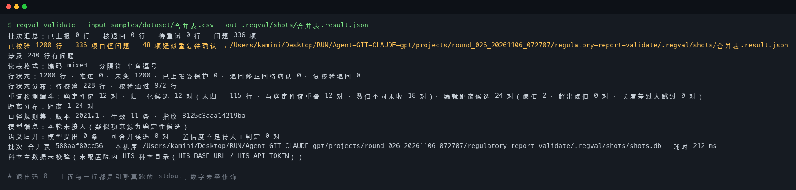
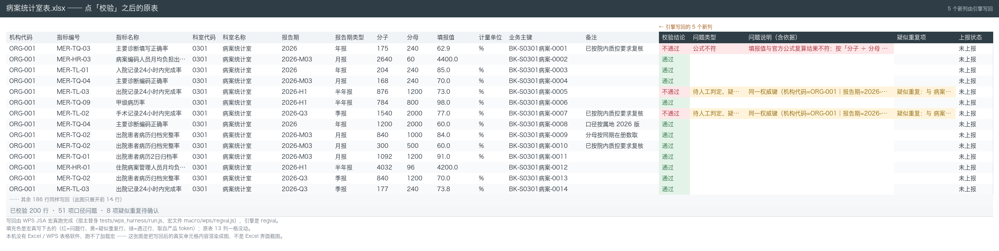
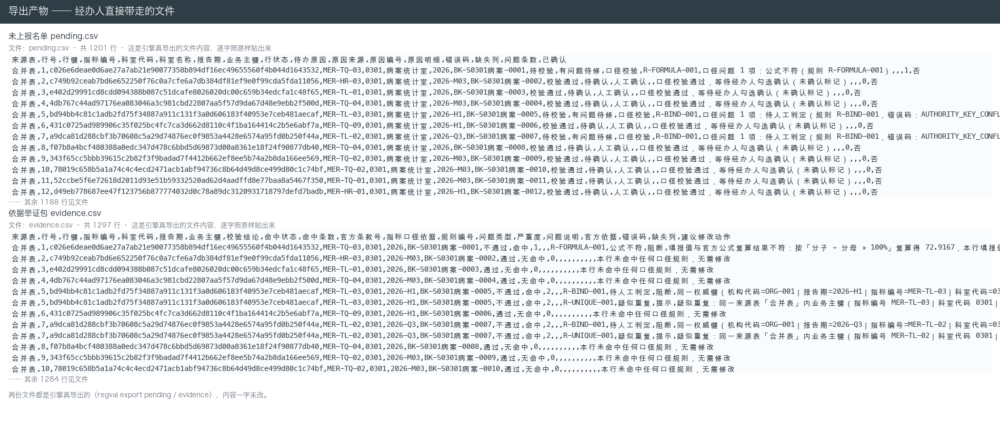
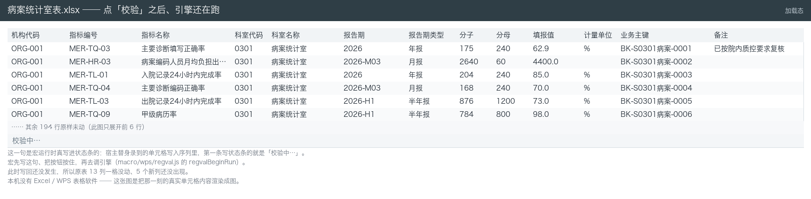
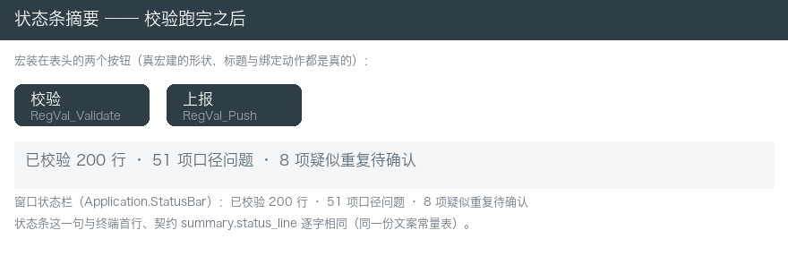
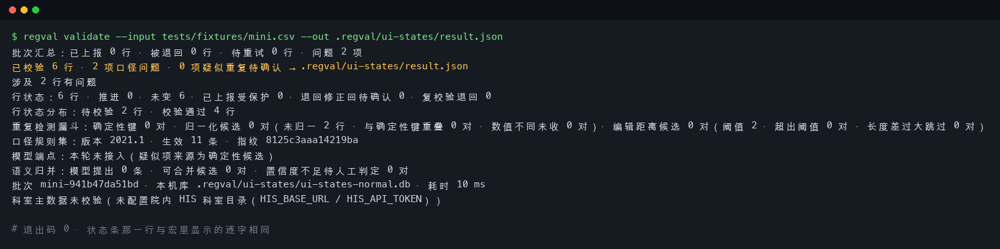
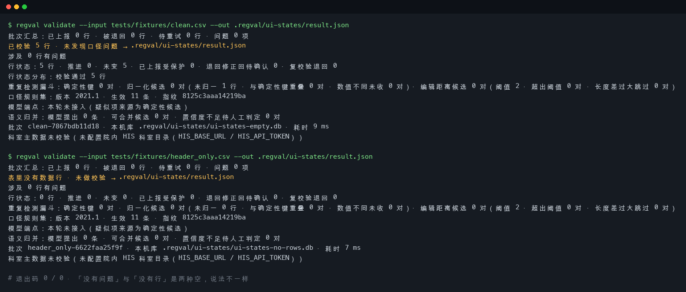
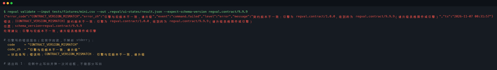

# 卫健上报校验系统
> 把各科室填好的几张卫健专项上报表并进模板，在原表内点一次「校验」，必填缺失、枚举越界、单位不符、疑似重复四类问题就地标出；经办人勾选确认后点「上报」，通过的行按幂等键推到院内上报网关，回执写回原表状态列。

科室仍然在自己的表格里干活。不另开网页、不做门禁看板、不换系统。

---

## 适用场景 / 目标岗位
| 岗位 | 什么时候用 | 得到什么 |
|------|------------|----------|
| 信息科数据管理员（经办） | 报告期收齐各科室专项上报表，要一张表一张表人工核对再汇总 | 在原表右侧看到 5 个新列，逐行标出哪一行不合格、缺哪几列、按哪条口径、怎么改 |
| 医务科质控专员（复核） | 校验跑完，要逐条确认疑似重复到底是不是同一条 | 一份可勾选的疑似重复对照（含匹配依据），勾完才允许上报 |
| 信息科数据管理员（经办） | 确认完了，要把这一批指标推到院内卫健上报网关 | 推送按幂等键去重，重复点「上报」不会重复推；网关退回的行带回错误码和字段名 |
| 信息科数据管理员（经办） | 报告期截止前，要催还没交的科室 | 一张「已收到 / 未收到」催报对照，按科室和报告期分组，每行写清待办原因 |
| 质控专员 | 口径文件换版了，要看这次换了哪几条 | 新旧口径逐指标差异清单（必填/枚举/单位/公式的前后取值），换版前给科室看 |
| 院领导 / 质控岗 | 要留档核对这批数据是怎么报上去的 | 每行依据举证包 + 回执导出，可按幂等键与回执 ID 交叉核对 |

## 能力要点
- **在原表里干活，不另开网页**：表里就两个按钮（校验 / 上报）加一行状态条。点一次「校验」，结论就写在自己那张表的右边；状态条一句话说清「已校验多少行 · 有多少项口径问题 · 有多少项疑似重复待确认」。
- **口径按版本走，每条问题带官方依据**：规则写错了不会静默放行——报出错的词和位置，这一条规则不生效，其余照常跑；属地口径换版未经质控岗确认不生效，生效日期没到同样不启用。
- **重复项分级查、只标不合并**：完全一致 → 归一化（全半角、别名写法）→ 编辑距离近邻 → 模型语义归并，四级漏斗逐级给出候选和命中理由，一律标「疑似」，合并与否由经办人勾选。
- **模型挂了照样交活，且留痕**：模型端点连不上或超时，校验照跑、结果照出，只是这批疑似项标明只来自确定性三级；每次调用都记进本机库的调用审计表。要「模型不可用就不许降级」，加 `--require-model`。
- **上报不会重推**：同一行重复提交命中幂等键就不再发请求；网关退回的行带回错误码与字段名，5xx 和超时按退避重试，重试耗尽转「待重试」进未上报名单。
- **状态只由回执推进**：模型不推进状态、本地时钟不推进状态，只有网关回执能把行标成「已上报」。下期打开同一模板只剩没报的行；谁在什么时候确认了哪一行、哪张回执对应哪个幂等键，都能按行、按批次回放，本机状态库万一损坏还能按幂等键与回执记录恢复到最后一个一致状态。
## 快速开始
### 依赖
| 项 | 版本要求 | 说明 |
|----|----------|------|
| Rust | ≥ 1.85（edition 2021） | 构建工具链；`cargo --version` 查得到即可。默认 `PATH` 不含 `~/.cargo/bin` 时先 `export PATH="$HOME/.cargo/bin:$PATH"` |
| SQLite | 随 `rusqlite` bundled 编译 | 引擎自带，不需要单独装数据库服务 |
| Excel / WPS | 支持加载宏的桌面版 | 表格内插件的运行载体；专网报送机无宏环境时用 CSV 直跑。校验环节可完全离线，只有上报与查科室目录需要网络 |

### 安装
```bash
cd regulatory-report-validate
export PATH="$HOME/.cargo/bin:$PATH"   # 若 cargo 不在 PATH 中
cp .env.example .env                   # 按院内实际地址填写（凭据只从环境变量读）
cargo build --release                  # 产物在 target/release/regval
```
> **院内专机没有外网？** `./scripts/offline-build.sh --vendor` 在联网机上生成依赖目录，拷到专机后 `./scripts/offline-build.sh` 即可 `cargo build --release --offline` 编出二进制。完整的**离线构建 / 目录布局 / 环境变量注入 / 宏导入与权限 / 运维清单 / 2 分钟最小验证**见 [`docs/install.md`](docs/install.md)。

### 配置
`.env` 里的值按院内实际地址填写。引擎启动时会读工作目录下的 `.env`，**进程环境优先**；变量缺失时**不用默认值兜底**，直接以 `CONFIG_MISSING` 退出并点名缺哪几项。装机器时先跑一次 `regval doctor` 看缺什么。

| 配置项 | 默认值 | 说明 |
|--------|--------|------|
| `REGULATORY_REPORT_BASE_URL` / `REGULATORY_REPORT_TOKEN` | 无（必填） | 院内卫健上报网关根地址与 Bearer 凭据，缺失时在发请求前就报错退出 |
| `HIS_BASE_URL` / `HIS_API_TOKEN` | 无（配了才核对科室主数据） | 拉科室主数据目录用；**不配也能跑** —— 那时结果里标「科室主数据未校验」 |
| `OPENAI_BASE_URL` / `OPENAI_API_KEY` / `OPENAI_MODEL` / `OPENAI_TIMEOUT_SECS` | 无（语义归并时必填） | 模型端点；不可达时只标「疑似」，主路径照跑 |
| `REGVAL_STATE_DB` / `REGVAL_RULE_DIR` | 无（必填，`.env` 已给出 `./.regval/state.db` 与 `./rules`） | 本机校验库文件（行列结论、确认、回执、审计链）与口径规则目录（版本化规则表 + 指标口径种子 + 重复检测阈值） |

> 完整配置项清单（编辑距离阈值、退避重试、缓存有效期、日志门槛等）见 [`docs/cli.md`](docs/cli.md)。**还没拿到院内接口的，把 `.env` 里那几行占位地址删掉** —— 删掉后行为是确定的：科室维度标「科室主数据未校验」，模型端点标「本轮未接入」，两条都**不阻塞**主路径。

### 构建与验证
```bash
cargo test                                              # 单测 + 集成测试 + 契约测试
cargo run -- validate --input tests/fixtures/mini.csv --out /tmp/regval-result.json
```

跑通后终端给出下面这段（**逐行真实输出**，只有「耗时」一行随机器而变）：
```text
已校验 6 行 · 2 项口径问题 · 0 项疑似重复待确认 → /tmp/regval-result.json
行状态分布：待校验 2 行 · 校验通过 4 行
口径规则集：版本 2021.1 · 生效 11 条 · 指纹 8125c3aaa14219ba
```

其中**第一行就是宏的状态条那句话**（宏直接取契约 `summary.status_line`，不自己统计）。完整 stdout 见 [`docs/examples.md`](docs/examples.md)。

### 上报 → 导出 → 状态：完整跑一遍
院内真实网关的地址与凭据在 `.env` 里；**离线想先跑一遍**，把地址指向随包附带的协议替身（`tests/gateway_stub/stub_server.py`，只用 Python 标准库）：在终端 A 起 `python3 tests/gateway_stub/stub_server.py --port 8731 --token stub-token`，在终端 B 把 `REGULATORY_REPORT_BASE_URL` / `REGULATORY_REPORT_TOKEN` 指过去，再按四步走：**校验 → 逐行确认 → 上报 → 导出与查状态**。
```bash
cargo run -q -- validate --input tests/fixtures/clean.csv --out /tmp/regval-clean.json --state-db /tmp/q.db
cargo run -q -- push --batch clean-7867bdb11d18 --state-db /tmp/q.db
```
> **上报是串行的**：第 k 步没受理，第 k+1 步起**都不执行**（批末条件回滚，批次汇总回到批前值，但已成功行的行级回执保留 —— 网关侧已受理的事实不可撤销）。一行没过校验又没人工确认，会被写闸门以 `UNCONFIRMED_ROW` 拦下（**一个字节都没往网关发**）—— 先把那行修好或确认掉，再重跑即可续跑。

### 主命令速查
```bash
regval validate --input <表> --out <结果.json>   # 读表 → 落本机库 → 跑口径规则 → 出结果契约
regval push    --batch <批次>                    # 按幂等键把已确认行提交到上报网关（重跑即续跑）
regval status  --batch <批次>                    # 看批次汇总与行状态分布
regval rules / rules approve --version <版本> --approver <姓名>   # 规则清单与换版闸门 / 质控岗确认新口径
regval export  evidence|pending|receipts|diff --out <path>  # 导出举证包/未上报名单/回执/口径差异清单
regval merge   --batch <批次> --row <保留行键> --drop <并入行键> --by <确认人>   # 应用一条已勾选的合并
regval confirm --row <行键> --by <确认人>        # 记一条人工确认（确认人/时间/行键都留痕）
regval replay  --batch <批次> --rule-version <版本>       # 按原规则版本复算历史批次
regval doctor                                  # 逐项自检：工具链、状态库、规则目录、凭据
```
> 其余子命令（`push --plan` / `dept` / `bench` / `compare` / `confirmations` / `recover` / `audit` / `tokens` / `messages` / `macro`）见 [`docs/cli.md`](docs/cli.md)。

### 在 Excel 里怎么用（表格内插件）
科室的日常路径不开网页、不另建台账 —— 就在自己那张表里：

1. 把 `macro/vba/RegVal.bas`、`macro/vba/RegValTokens.bas` 与 `macro/vba/RegValMessages.bas` 导入工作簿（**三个模块都要导**），`Alt+F8` 运行 `RegVal_InstallBar`，表右侧出现「校验」「上报」两个按钮，数据下面出现一行浅灰状态条；
2. 点「校验」→ 结果写回原表右侧 5 个新列；逐条勾选确认后点「上报」→ 回执回填「上报状态」列（绿=已上报 / 橙=被退回 / 灰=待重试）。

原表的其它列、格式与公式一个字节不动；引擎与宏版本对不上时提示「引擎与宏版本不一致，请升级」并中止写回。Excel / WPS / CSV 三条入口**共用同一份 JSON 契约、同一套判定**；导入方式与目录权限见 [`macro/README.md`](macro/README.md)。
## 命令 / API / 配置说明
### 关键配置项
| 约定 | 说明 |
|------|------|
| 凭据来源与缺项处理 | 一律环境变量（`.env` 只用于本机开发，已被 `.gitignore` 排除）；缺项即 `CONFIG_MISSING` 退出并点名缺哪几项，**不用默认值兜底**；取值格式不对报 `CONFIG_INVALID` |
| 状态库位置 | `REGVAL_STATE_DB` 指向的单文件 SQLite；随行结论、确认记录、回执、审计链 |
| 规则目录 | `REGVAL_RULE_DIR`；规则带版本号，旧版本 `superseded` 保留可追 |
| 应交科室名册 | 催报对照的「未收到」一列取自 `REGVAL_RULE_DIR/roster.json`；名册里没有的科室不催 |
| 重复检测阈值 | 第 3 级（编辑距离）的尺度是数据不是代码：环境变量或规则目录里的 `dupe-distance.json`；调参文件写坏了直接报错 |
| 只读模式 | 未人工确认的行一律不允许进入推送，不靠配置开关绕过 |
| 退避重试与断点续跑 | 网关 5xx / 超时 / 连不上 → 退避重试（复用**同一个幂等键**），**退回（4xx）不重试**；批次中断后重跑，已上报的行**不重复推送**，订正后重报的行按**修订号**判定 |
| 日志与自检 | 结构化 JSON 行日志写到 **stderr**；`regval doctor` 逐项检查工具链、状态库、规则目录与每个变量 |

> 全部环境变量与默认值见 [`docs/cli.md`](docs/cli.md)。

### CLI 子命令 / 接口端点
| 命令或路径 | 用途 | 关键参数 |
|------------|------|----------|
| `regval validate` | 读表并产出结果契约 JSON | `--input <path>` `--out <path>` `--state-db <path>` `--expect-schema-version <v>` `--error-out <path>` `--require-model` |
| `regval push` | 提交已确认行到上报网关（编译条件批量程序 → 过写闸门 → 逐步上报 → 回执写回；中断后重跑即续跑） | `--batch <ref>` `--out <path>` `--error-out <path>` `--plan` `--preview` |
| `regval status` / `rules` / `rules approve` | 批次汇总与行状态分布 / 规则清单与装载状态 / 记一条换版确认 | `--batch <ref>` `--dir <path>` `--version <v>` `--approver <姓名>` `--out <path>` |
| `regval merge` / `confirm` / `revoke` / `confirmations` | 应用一条已勾选的疑似重复合并 / 记一条人工确认 / 撤销确认 / 查看确认记录 | `--batch <ref>` `--row <行键>` `--drop <并入行键>` `--by <确认人>` `--with <对方行键>` `--note <理由>` |
| `regval export` | 导出举证包 / 未上报名单 / 回执 / 口径差异清单 / 编辑距离候选 | `evidence\|pending\|receipts\|diff\|dupe` `--out <path>` `--batch <ref>` `--from-version <v>` `--to-version <v>` `--reminder-out <path>` |
| `regval replay` / `doctor` / `dept` | 按原规则版本复算历史批次 / 环境与凭据逐项自检 / 查看科室主数据目录状态 | `--batch <ref>` `--rule-version <v>` `--state-db <path>` |
| `regval bench` / `compare` / `audit` / `recover` | 跑标注基准集出逐级召回率 / 精确率 / 与基线方案对比 / 回放审计链并核对幂等键 ↔ 回执 ID / 状态库损坏时恢复到最后一个一致状态 | `--bench-dir <目录>` `--input <表>` `--out <path>` `--row <行键>` `--idempotency` `--apply` |
| `POST {REGULATORY_REPORT_BASE_URL}/api/v1/regulatory-submissions` | 出站写：提交一行上报 | 头 `Authorization: Bearer`、`Idempotency-Key`；body 15 字段 |
| `GET {HIS_BASE_URL}/api/v1/dept-directory` | 出站读：科室主数据目录 | 头 `Authorization: Bearer`；响应 `[{dept_code, dept_name, aliases[], parent_code}]` |

> 每个子命令的完整参数与行为见 [`docs/cli.md`](docs/cli.md)。

### 错误与降级
| 场景 | 表现 | 处理方式 |
|------|------|----------|
| `CONTRACT_VERSION_MISMATCH` | 引擎与表格宏的契约版本对不上 | 宏提示「引擎与宏版本不一致，请升级」并中止写回，不做部分写回 |
| `RULE_SYNTAX_ERROR` / `RULE_SWITCH_UNCONFIRMED` | 口径规则 SQL 语法错 / 目录里出现了没确认过的新版本 | 前者报出出错词与偏移、该规则标为不生效、其余照常执行；后者本轮继续用旧版并说明哪一版没生效 |
| `MISSING_COLUMN` / `DENOMINATOR_ZERO` / `INVALID_NUMERIC` | 表头缺必需列 / 比率型指标分母为 0 / 分子分母是负数或非数值 | 报明确缺哪一列，不猜列；分母为 0 单独归类不报成「公式不符」；非数值归入数据形态错误，都不做静默处理 |
| `UNCONFIRMED_ROW` | 这一行没过写闸门：没有人工确认、确认被撤销过，或行状态还不在可推送状态 | 写闸门**不往网关发这个请求**（一个字节都不发）；补确认或改完数据重新校验后再报 |
| `INVALID_STATE_TRANSITION` / `ROW_STATE_CONFLICT` | 行级状态迁移不在合法迁移表里 / 同一行刚被另一个动作推进过 | 拒绝推进并报错，**行状态一个字节都不改**；重跑当前动作即可 |
| `GATEWAY_REJECTED` / `GATEWAY_SERVER_ERROR` / `GATEWAY_TIMEOUT` / `GATEWAY_RESPONSE_INVALID` | 网关 4xx 退回 / 5xx / 超时 / 回了 200 但回执结构不合法 | 退回即置「被退回」不重试；5xx 与超时退避重试，耗尽转「待重试」，**不改成已上报**；回执不合法时**不当成成功**，该行标「回执待人工核对」 |
| `MODEL_UNAVAILABLE` | 模型端点不可达 / 超时 / 返回不合法 | 默认降级：只给确定性候选并一律标「疑似」，主路径不阻塞；加 `--require-model` 时直接退出 |
| `DEPT_NOT_FOUND` / `DEPT_DIRECTORY_UNAVAILABLE` | 科室代码匹配不到 HIS 目录 / 目录整体拉不到 | 前者报「科室主数据不一致」（阻断级）；后者标「科室主数据未校验」，**不静默通过** |
| `CONFIG_MISSING` / `CONFIG_INVALID` / `DB_CORRUPTED` | 环境变量缺项或格式不对 / 本机状态库文件损坏 | 前两者点名缺哪几项并给出补法；后者**不静默重建空库**，跑 `regval recover` 恢复后 `--apply` 换上去（原库留成备份） |

> 完整错误码全表（约 35 项）与逐项处置见 [`docs/cli.md`](docs/cli.md)。

### 对接现有系统
**上报网关（出站写）**：`POST {REGULATORY_REPORT_BASE_URL}/api/v1/regulatory-submissions`，凭据 `Authorization: Bearer $REGULATORY_REPORT_TOKEN`（环境变量），随请求带 `Idempotency-Key` 头。body 字段固定 15 项（`batch_ref` / `reporting_period` / `org_code` / `indicator_code` / `dept_code` / `business_key` / `numerator` / `denominator` / `value` / `unit` / `basis` / `rule_version` / `idempotency_key` / `payload_digest` / `revision`），不多传不少传。响应语义：`200 {receipt_id, accepted_at, status}` → 已上报；`4xx {error_code, error_field, message}` → 被退回（带错误码与字段名）；`5xx` 与超时 → 退避重试，重试耗尽转「待重试」；`200` 但回执缺字段 → 不当成成功，该行标「回执待人工核对」。

**HIS 科室目录（出站读）**：`GET {HIS_BASE_URL}/api/v1/dept-directory`，`Authorization: Bearer $HIS_API_TOKEN`，响应 `[{dept_code, dept_name, aliases[], parent_code}]` —— 科室代码是权威标识，名称与别名是合法写法。查不到 → 报「科室主数据不一致」（阻断级）；名称写法不符 → 只提示、不阻断、不改数。拉不到时降级为「科室主数据未校验」并标出原因，**空目录不当成「没有科室」**；退回上次缓存时**标注数据时间**，超过有效期（`REGVAL_DEPT_DIRECTORY_TTL_SECS`，缺省 1 小时）标「已超过有效期」。

**验证方式**：协议兼容替身只出现在 `tests/` 测试数据层，用于断言请求路径、请求头与 body 字段全集；它**不是**最终对接方式，产品代码走的是上面的正式协议。详见 [`docs/cli.md`](docs/cli.md)。
## 典型场景
### 场景 1：信息科报告期收表后逐表校验
1. 把 3 张科室上报表并进同一个模板，按指标编号和科室代码对齐，在表内点「校验」；
2. 引擎落本机库、跑版本化口径 SQL，把结果写回原表右侧 5 个新列；得到：12 行标出口径问题（缺哪列、期望取值、依据出处），5 行标出疑似重复待确认，表底状态条显示「已校验 200 行 · 12 项口径问题 · 5 项疑似重复待确认」。
```bash
regval validate --input 院感专项上报表_模板.xlsx --out /tmp/regval-result.json
```

### 场景 2：质控专员逐条勾选确认疑似重复
1. 在「疑似重复项」列看每对的匹配依据（完全一致 / 归一化后一致 / 编辑距离近邻 / 模型语义归并），勾掉确实重复的行；模型给的疑似项必须逐条勾选才合并，没勾的一律按「疑似」留着；
2. 得到：确认记录带确认人与确认时间进审计链；未确认的行被写闸门拦住，推送时报 `UNCONFIRMED_ROW`。
```bash
regval confirm --row <行键> --by 张老师 --note "两行是同一笔记录"
regval merge --batch 2026-Q3-院感 --row <保留行键> --drop <并入行键> --by 张老师
```

### 场景 3：推送上报并留档核对
1. 点「上报」，引擎按幂等键把**已确认**的行推到院内网关；没过校验的行推不出去，会被写闸门以 `UNCONFIRMED_ROW` 拦下；网关回执回填「上报状态」列：绿底「已上报」/ 橙底「被退回」/ 灰底「待重试」，被退回的行带回错误码与字段名；
2. 得到：同一批次再点一次「上报」，幂等键命中，不产生新的推送请求；导出回执台账与每行依据举证包可按幂等键与回执 ID 交叉核对（对不上时退出码非 0）；中途网关 5xx 断掉了，**修好之后重跑一次「上报」即可续跑**，已成功的行一个请求都不再发。
```bash
regval push --batch 2026-Q3-院感
regval export receipts --out 回执_2026-Q3.csv     # 台账 + 幂等键↔回执号核对结论
```
> 其余场景（口径换版闸门、状态库损坏恢复、专网机 CSV 直跑、报告期截止催报）见 [`docs/examples.md`](docs/examples.md) 与 [`docs/architecture.md`](docs/architecture.md)。
## 输出样例
### 校验结果契约 JSON（`regval validate` 的产物）
引擎与表格插件之间只交接这一份契约，带 `schema_version`、5 个新列的列定义与逐行结果。真实运行（`tests/fixtures/mini.csv`，6 行脱敏样例）的截取：
```json
{
  "schema_version": "regval.contract/1.0.0", "batch_ref": "mini-941b47da51bd",
  "columns": [{ "name": "校验结论", "index": 1 }, { "name": "问题类型", "index": 2 }, { "name": "问题说明（含依据）", "index": 3 }, { "name": "疑似重复项", "index": 4 }, { "name": "上报状态", "index": 5 }],
  "summary": { "total_rows": 6, "rows_with_issues": 2, "issue_count": 2,
               "issue_count_by_kind": { "必填缺失": 2 }, "suspected_duplicate_count": 0,
               "status_line": "已校验 6 行 · 2 项口径问题 · 0 项疑似重复待确认" },
  "rows": [{ "row_uid": "ba4e8a37…", "indicator_code": "MER-TL-04", "dept_code": "0301", "reporting_period": "2026-Q3", "conclusion": "通过", "submission_status": "未上报" }],
  "issues": [{ "rule_id": "R-REQUIRED-001", "issue_kind": "必填缺失", "severity": "阻断", "message": "缺少必填列「指标名称」", "missing_columns": ["指标名称"], "basis": "国卫办医函〔2021〕28号 附件《病案管理质量控制指标（2021年版）》" }],
  "suspected_duplicates": []
}
```
> 插件读到对不上的 `schema_version` 一律拒绝写回（`CONTRACT_VERSION_MISMATCH`），不做部分写回。`summary.status_line` / `summary.submission_line` 是**成品句子**：表格插件的底部状态条与终端第一行输出打的是同一句。

### 上报发送与导出产物（`regval push` / `regval export`）
发送路径跑的是**条件批量提交程序**：第 i 步只在第 i-1 步成功后执行；每一步的裁决逐行打印，回执落进本机库，「上报状态」列随之回填。真实运行（5 行全部被网关受理）：
```text
提交计划：待上报 5 步 · 已跳过 0 行 · 待人工判定 0 行
第 1 步  行键 413cc083…  已执行  已上报 · 回执 RCPT-0001 · 受理时间 2026-11-07 06:01:03 · accepted
本轮：计划 5 步 · 尝试 5 步 · 已上报 5 行（受理 5 · 幂等命中 0）· 被退回 0 行 · 待重试 0 行 · 未发出 0 行
回执落库：行 5 · 回执 5 · 已上报 5 · 被退回 0 · 待重试 0 · 回执待核对 0 · 未发出 0
```

导出各是一份可归档、可交叉核对的正式产物（列名与顺序固定，第三方按这套列核对），例如未上报名单：
```csv
来源表,行号,行键,指标编号,科室代码,科室名称,报告期,业务主键,行状态,待办原因,原因来源,原因编号,原因明细,错误码,缺失列,问题条数,已确认
pending_report,1,5a8a76becc75b4f3…,MER-TL-04,0301,病案统计室,2026-Q3,BK-PEND-01,校验通过,待确认,人工确认,,口径校验通过，等待经办人勾选确认（未确认标记）,,,0,否
```
> 依据举证包、回执台账、科室目录状态、模型调用审计、恢复报告等全部样例见 [`docs/examples.md`](docs/examples.md)。
## 概念 / 实测对照
### 视觉目标
`docs/concepts/visual-goal.md` 是本产品的**结构化视觉目标卡**：三个状态（起始态 / 首个可用瞬间 / 成形态）的画面描述、配色（底色与字色的具体色值）、字体族与字号、信息层级、留白密度，以及「只用 Excel / WPS 原生单元格填充色、字体、状态栏文本、单元格批注就能做出来」这一必须可达的约束。本轮运行环境不具备图像生成能力，因此**没有概念图**，也不放占位图——只有这份可逐条对照的卡片。

### 实测证据
真实运行截图采集到 `docs/screenshots/`，共 8 张。两支脚本都在仓里、可重跑：`python3 scripts/capture_ui_states.py`（三态）与 `python3 scripts/capture_screenshots.py`（写回 / 导出 / 加载态 / 状态条）。

| 截图 | 来源 | 怎么采的 |
|------|------|----------|
|  | `regval validate --input samples/dataset/合并表.csv` | 引擎 stdout 原文，一行未改 |
|  | 点「校验」之后的原表（200 行） | WPS JSA 宏真跑写回，填色是宏真写下去的 |
|  | `regval export pending` / `export evidence` | 真导出文件的内容原文 |
|  | 点「校验」之后、引擎还在跑的那一刻 | 宿主替身录到的单元格写入序列 |
|  | 写回完成后的状态条与表头两个按钮 | 宏真写下去的状态条与形状 |
|  | `regval validate --input tests/fixtures/mini.csv` | 引擎 stdout 原文 |
|  | `clean.csv`（零问题）与 `header_only.csv`（没有行） | 引擎 stdout 原文 |
|  | `--expect-schema-version regval.contract/9.9.9` | 引擎 stdout 原文 + 错误报告 JSON |

> **这些截图是什么**：引擎与宏真跑出来的内容，逐字照原样渲染 —— 写回那张里的行、问题数、填色都是宏实际写下去的；导出那张是导出文件的内容原文。宏侧状态条上写的就是同一句话。
>
> **这些截图不是什么**：**不是 Excel / WPS 表格软件的界面截图** —— 本机没装，跑不了加载宏。表格那两张是把「写回后的真实单元格内容 + 宏真写下去的填充色」渲染成图。**不拿渲染图冒充 Excel 截图。**
>
> **诚实标注**：上面「视觉目标」侧是设计意图的卡，下面「实测证据」侧是真实运行产物。目标与实现在视觉上**必然有差距**——目标卡描述的是理想版式，实测截图反映的是实际机器上的字体度量、列宽自适应与长文本截断表现；写回那张图只展开前 14 行（其余 186 行同样写回），导出那张只贴前 13 行。**不声称两者完全一致**，也不会生成「事后效果图」去抹平差距。
## 架构与数据流
```
  科室专项上报表 (xlsx / csv)
              ▼
  ┌────────────────────────────────────────────────────────────┐
  │ ① 读表与表头映射 ingest/*   缺列→MISSING_COLUMN；空串判缺失 │
  │ ② 本机校验库 db/*（bundled SQLite）一次事务批量落库，6 张表  │
  │ ③ 口径规则引擎 rules/*  装载即语法预校验·参数化执行          │
  │    四类检查器（必填/枚举/单位/公式复算）+ 27 项官方口径种子  │
  │ ④ 重复检测四级漏斗 dupe/*  exact→normalize→distance→semantic│
  │    一律标「疑似」不自动合并；模型不可达只给确定性候选        │
  │ ⑤ 结果契约 JSON contract.rs  schema_version+列定义+行结果    │
  └───────────┬───────────────────────┬────────────────────────┘
              ▼                       ▼
   Excel 加载宏                WPS JSA 宏 / CSV 直跑
   （写回原表 5 个新列，原表格式与公式不动）
              ▼
   经办人逐条勾选确认 ──▶ confirmations 表（确认人/时间/行键）
              ▼
  ┌────────────────────────────────────────────────────────────┐
  │ ⑥ 上报发送 push/*  恢复台账→写闸门→条件链逐步推→回执落库    │
  │    第 i 行只在第 i-1 行成功后提交；中断后重跑即续跑          │
  └───────────────────────────┬────────────────────────────────┘
                              ▼
     POST 院内卫健上报网关（Bearer + Idempotency-Key）
                              ▼
     回执 → receipts 表 → 行级状态推进（已上报/被退回/待重试）
              │
              ├─▶ 审计链 audit_log（append-only：谁/何时/哪一行/做了什么）
              └─▶ 恢复日志 <状态库>.journal（幂等键 ↔ 回执 ID + 批次提交标记）
                              ▼
     批次汇总落库（一次事务：批次计数+汇总值+批次状态同生共死）
                              ▼
     regval status / 未上报名单 / 依据举证包 / 回执导出 / audit / recover
```

### 关键不变量
- **幂等键**：由机构、报告期、指标编号、科室代码、业务主键派生，与时间戳、重试次数无关；同一业务行两次计算结果相同，订正改的是载荷摘要（`payload_digest`），不是业务键。
- **写闸门**：只有「有有效人工确认记录」且「行状态处在可推送状态（待确认 / 待重试）」的行才允许推送；没过闸门**一个字节都不往网关发**。确认可撤销，撤销后该行退回「校验通过」，需重新确认。
- **状态单一入口**：行状态只由状态机改，且只由网关回执驱动；模型与本地时钟都不推进状态；不在合法迁移表里的推进一律拒绝（`INVALID_STATE_TRANSITION`），并发推进后写者被拒（`ROW_STATE_CONFLICT`）。
- **失败不静默改数据**：规则语法错 → 该规则不生效并报错；缺列 → 报错不猜列；第 k 步失败 → 第 k+1..N 步不执行，批次汇总回到批前值，**已成功行的行级回执保留**（网关侧已生效的事实不可撤销）。
- **批次汇总一次事务**：批次计数、汇总值与批次状态要么全落、要么全不落；同一版汇总写第二次会撞历史表唯一索引并整次回滚（重放防护）。
- **原表只读**：引擎只读原表，写回只新增 5 列，其余列、格式与公式不动。
- **模型不可用不阻塞、也不许静默降级**：端点不可达 / 超时 / 响应不合法 → 只输出确定性候选并一律标「疑似」，疑似项来源标 `deterministic`；`--require-model` 时直接以 `MODEL_UNAVAILABLE` 退出，不产出契约、不改业务数据。
- **幂等键 ↔ 回执 ID 一一对应**：每个 `(幂等键, 修订号)` 至多一条回执、每个回执号只挂一个幂等键，`regval audit --idempotency` 随时能查出破口。进程重启后先恢复台账：已报上去的行判幂等命中不重推，没报上去的（待重试 / 未发出 / 未执行 / 回执待核对）一律回到上报程序。
- **库坏了不重建、不覆盖**：状态库损坏时报 `DB_CORRUPTED` 并指出恢复路径；`regval recover` 从恢复日志与原库残留恢复幂等键 ↔ 回执的对应关系，恢复产物写在另一个文件，**原库一个字节都不动**，要换上去得显式 `--apply`。
> 批次汇总口径、条件批量程序、幂等与回执、本机库表清单、行级状态机的完整说明见 [`docs/architecture.md`](docs/architecture.md)。
## 安全与合规边界
- 只处理**指标级监管数据**（科室 × 指标 × 报告期），不接入、不落库患者可识别明细。
- 模型只做重复项语义归并与差异说明草稿，输出**只标注不生效**；合并与上报必须由人确认。
- 不输出诊断或治疗建议，不自动签名、不代签；口径依据一律引用官方文件出处，不自行推断。
- 凭据只从环境变量读，不硬编码、不写入日志、不进版本库。
## 验收与自检
| 验收项 | 命令 | 期望结果 |
|--------|------|----------|
| 单元与集成测试 | `cargo test` | 全绿 |
| 环境与凭据自检 | `cargo run --release -- doctor` | 逐项列出工具链、状态库、规则目录、凭据的结论，不只输出 OK |
| 端到端校验 | `regval validate --input samples/dataset/合并表.csv --out /tmp/regval-result.json` | 产出 JSON：`rows` 1200 行、`issues` 336 项、疑似重复 48 对；读表编码识别为 `mixed` |
| 契约版本守护 | 用不匹配的 `schema_version` 调用宏侧写回 | 提示「引擎与宏版本不一致，请升级」并中止，不做部分写回 |
| 表格内插件界面 | `cargo test --test macro_ui_test` | 两个按钮与动作绑定在位；状态条句子由引擎算好，表里与终端同一句；带公式样例表写回后公式列一字未动 |
| 引擎错误可被宏读 | `regval validate --input 不存在的表.csv --error-out /tmp/err.json` | 非 0 退出并写出错误报告 JSON（`code` / `code_zh` / `message` / `advice`） |
| 未确认行被拦 | 对未确认批次跑 `regval push` | 返回 `UNCONFIRMED_ROW`，状态不变 |
| 人工确认流与写闸门 | `cargo test --test confirm_gate_test` | 未确认行被拦且**一个字节没发往网关**；确认后可推；撤销后又被拒、重新确认后可再推；空确认人不入库 |
| 幂等不重推 | 同一批次连跑两次 `regval push` | 第二次幂等键命中，不产生新的推送请求 |
| 离线跑通上报全路径 | `python3 tests/gateway_stub/stub_server.py --port 8731 --token stub-token` + 「快速开始 → 上报 → 导出 → 状态」四步 | 替身收到 5 个 `POST /api/v1/regulatory-submissions`（鉴权头与幂等头齐全、body 正好 15 项字段）；5 行拿到回执并推进到「已上报」；再推一次替身收到的请求数不变 |
| 批次汇总一次事务 | `cargo test --test batch_summary_test` | 事务中途失败后汇总值等于批前值、不留半截状态；批末回滚时汇总回批前值而行级回执仍留 |
| 行级状态机 | `cargo test --test row_state_machine_test` | 合法迁移逐条走通；非法迁移被拒且行状态与原值一致；并发推进后写者被拒；已上报的行不被普通校验改回 |
| 审计链与状态库恢复 | `cargo test --test audit_recovery_test` | 按行回放出完整确认与推送轨迹；幂等键 ↔ 回执 ID 一一对应成立且破口查得出；库坏后恢复，原库一个字节没动 |
| 规则错不静默 | 装载一条语法写错的规则 | 报出错词与偏移，该规则状态为不生效，其余规则照常执行 |
| 规模与性能基准 | `cargo test --release bench` | 5000 行完整校验 + 提交计划编译在阈值内（总耗时 ≤ 45 s、峰值常驻内存 ≤ 512 MB）；实测数值见 `docs/bench.md` |
| 与基线方案的可复现对比 | `cargo test --test baseline_compare_test` | 重复检测轴：朴素基线召回 100.00% / 精确 77.78%，四级漏斗召回 85.71% / 精确 85.71%；问题发现轴：仅规则校验 190 项问题，加公式复算后 240 项；结论见 `docs/baseline-comparison.md` |
## 项目结构
```
regulatory-report-validate/
├── Cargo.toml / .env.example / .gitignore   # 依赖清单与二进制名 / 环境变量清单（无真实凭据）/ 排除运行时产物，保留 qrcode.jpg
├── README.md / qrcode.jpg                   # 产品说明（本文件）/ 公众号二维码
├── docs/                    # 开发与运维文档（cli 子命令与错误码全表 / examples 完整真实输出 / architecture 汇总口径与状态机 / bench 性能基准 / baseline-comparison 基线对比 / dupe-funnel-bench 漏斗基准 / install 离线安装 / concepts 视觉目标卡 / screenshots 实测截图）
├── macro/                   # 表格内插件（三个入口共用同一 JSON 契约）
│   ├── vba/RegVal.bas       # Excel 加载宏：校验 + 上报两按钮 + 底部状态条 + 样式套用
│   ├── vba/RegValTokens.bas # 视觉 token 常量模块（**由 regval tokens --vba 生成**）
│   ├── vba/RegValMessages.bas # 提示文案常量模块（**由 regval messages --vba 生成**）
│   ├── wps/regval.template.js # WPS JSA 宏的手写模板（逻辑；常量由引擎注入）
│   ├── wps/regval.js        # WPS JSA 宏（**由 regval macro 装配生成**，与 VBA 同构）
│   └── README.md            # 宏导入、启用条件与版本对应说明
├── samples/                 # 脱敏样例集（脚本化合成，固定种子可重跑）：generate.py、dataset/（6 表 × 200 行 = 1200 行 + 合并表 + 科室目录）、dataset-scale/（10 表 × 500 行 = 5000 行，性能基准用）、bench/（标注基准集）
├── cases/                   # 官方口径同构用例集（卫健 27 项指标；期望值只写在这里）：README.md（格式、覆盖矩阵、跑法与三条纪律）+ 必填缺失 / 枚举越界 / 单位不符 / 疑似重复 / 边界（分母为 0、单位别名等）五组用例 JSON
├── rules/                   # 口径规则目录（版本化规则表 + 指标口径种子 + 重复检测阈值）
├── scripts/                 # 离线构建 / 打包 / 截图采集脚本
├── src/                     # 引擎源码（Rust）
│   ├── main.rs / lib.rs     # CLI 入口（clap：validate / push / status / rules / merge / confirm / export / replay / doctor / dept / bench / audit / recover / tokens / messages / macro）与库入口
│   ├── config.rs / doctor.rs / errors.rs / log.rs   # 环境变量配置 / 逐项自检 / 错误码体系 / 结构化日志与运行摘要
│   ├── contract.rs          # 引擎↔宏 JSON 契约（schema_version + 列定义 + 行结果）
│   ├── db/                  # 本机校验库：schema / repo / 迁移 / 批次汇总 / 模型审计 / 恢复日志 / 科室目录缓存
│   ├── ingest/ / bind/      # 读表与表头映射、行键与业务主键 / 权威归属判定、跨表对齐、科室主数据核对
│   ├── rules/ / dupe/ / compare/   # 口径规则引擎（装载、语法预校验、参数化执行、指标口径种子 + checks/ 四类检查器）/ 重复检测四级漏斗（精确、归一化、编辑距离、语义归并 + 评估）/ 与基线方案的可复现对比
│   ├── model/ / push/       # 单一 ModelGateway（OpenAI 兼容）+ 结构化校验 + 调用审计 / 幂等键、提交计划、条件执行、回执落库、网关客户端、科室目录、退避重试、批次汇总
│   ├── state/ / report/ / ui/   # 行级状态机、确认流、审计链与恢复 / 未上报名单、举证包、回执导出、差异清单 / 表格内插件的视觉层（具名 token + 状态条成品句子）
└── tests/                   # 单测、集成测试、契约测试、规模基准
    ├── cli_test.rs / model_gateway_test.rs / model_degradation_test.rs / semantic_merge_test.rs  # CLI 与模型端点：协议兼容、降级留痕、语义归并
    ├── confirm_gate_test.rs / batch_summary_test.rs / row_state_machine_test.rs                # 人工确认流、批次汇总事务、行级状态机
    ├── audit_recovery_test.rs / his_dept_directory_test.rs / pending_report_test.rs           # 审计链与恢复、科室目录、未上报名单
    ├── receipt_export_test.rs / macro_ui_test.rs / ui_tokens_test.rs / contract_macro_consistency.rs  # 回执台账与举证包、插件界面、视觉 token、契约一致性
    ├── three_entry_consistency_test.rs / baseline_compare_test.rs / install_doc_test.rs         # 三入口同构、与基线对比、离线安装说明
    ├── fixtures/            # 主干验证输入（脱敏最小样例 + 缺列样例 + 应交科室名册样例）
    └── gateway_stub/        # 协议兼容替身（仅测试数据层，不是最终对接方式）
```
## License
MIT

---

## 关注我们

欢迎扫码关注公众号，获取项目更新与交流加群：

